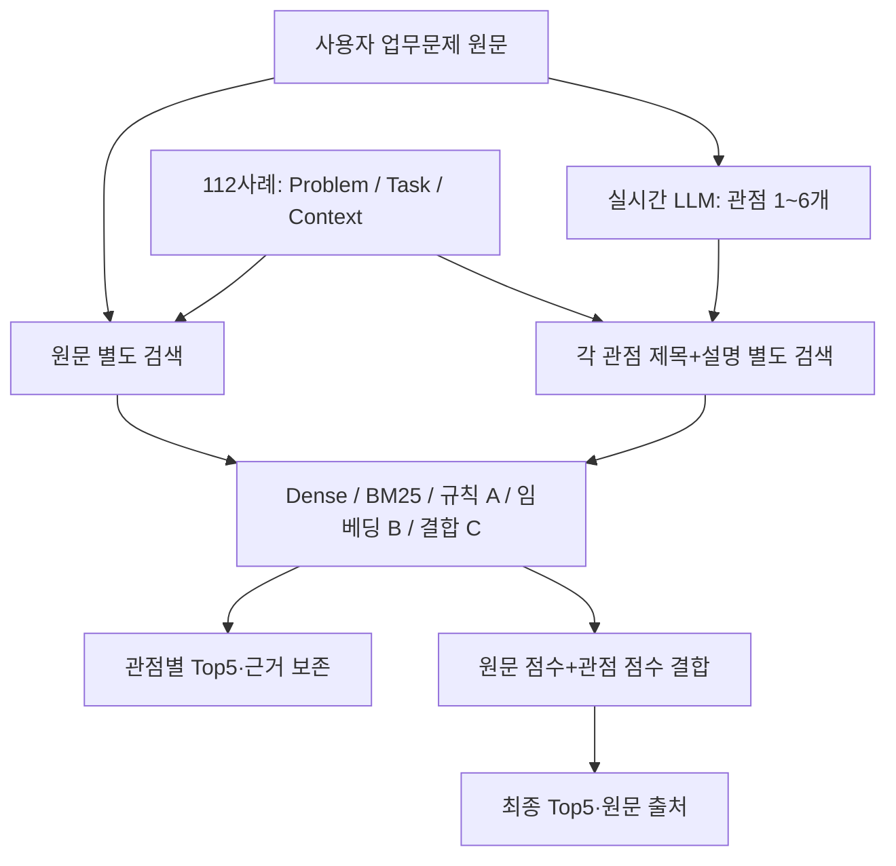

# AX 연구 · 교수님 검토 안내

**기업 업무문제를 여러 관점으로 나누어, 실제 AX 사례의 수행 기능과 연결하는 검색·전략 추천 연구입니다.** 현재 112개 사례 검색 시연과 개발 자료 실험까지 구현했습니다. 다중관점 고유 효과, 독립 Test 성능, 최종 전략 추천의 유효성은 아직 입증하지 못했습니다.

2026-10-28 · 최신 시연 `dd281118`에서 분기한 `review/professor-ax-research-20261028`.
[한 장 요약·검토 질문](docs/professor-review/overview.md) · [실행·재현 가이드](docs/professor-review/guide.md) · [실제 검증 기록](docs/professor-review/validation.md) · [기존 README 전체](README-history.md)

## 연구 개요와 접근 방식

업종·단어가 비슷한 사례만 찾는 대신 **어떤 행동을 어떤 대상에 수행했는지**를 비교합니다. 원질문을 유지하면서 LLM이 생성한 각 문제 관점을 별도로 검색하고, 관점별 근거와 최종 Top5를 보여줍니다. 추천 점수는 정답 확률이 아닙니다.



**원문을 각 관점에 붙여 검색하지 않습니다.** 원문과 각 관점을 독립적으로 검색한 뒤 점수를 결합합니다. 실시간 시연과 학술 오프라인 실험의 후보 집계·동점 조건은 일부 다릅니다. [정확한 공식·구현 차이](docs/professor-review/guide.md#검색-정책과-구현-차이)

## 시연 실행 퀵스타트

Windows PowerShell, 저장소 루트에서 실행합니다. GitHub 화면 자체에서는 앱이 실행되지 않습니다.

```powershell
git clone --branch review/professor-ax-research-20261028 --single-branch https://github.com/comjung-star/AX-research.git
cd AX-research
python -m venv .venv
.\.venv\Scripts\python.exe -m pip install -r requirements-v25-dev.txt
$env:AX_BGE_MODEL_PATH='C:\AX-models\bge-m3'
powershell -ExecutionPolicy Bypass -File .\run_professor_demo.ps1
```

별도 준비: **BAAI/bge-m3 로컬 모델 전체 디렉터리**와 **OpenAI API 키**가 필요합니다. 가중치는 저장소에 포함하지 않으며 앱은 자동 다운로드하지 않습니다. 키는 Windows 보안 저장소 또는 환경변수 `OPENAI_API_KEY`로 설정합니다. `AX_LLM_MODEL` 미설정 시 `gpt-6-luna`를 사용합니다. [키 비노출 설정·모델 준비](docs/professor-review/guide.md#새-pc-준비)

준비 완료 후 [로컬 시연 화면](http://127.0.0.1:8766)을 엽니다. 매 검색마다 입력을 OpenAI로 보내며 **API 비용이 발생**합니다. 인터넷·모델 사용 권한·잔액이 필요합니다. 실패하면 오류를 표시합니다. 시연 순서: 관점 목록 → 관점별 추천 → 최종 추천의 Task·Action·Object·출처 확인.

## 데이터·실험·성능 요약

|항목|현재 범위·근거|
|---|---|
|검색 사례|112개: 과거 개별 출처 검토 106 + 저장 원천 행 검토 6. [판정·출처](data/v2_5/research/README.md), [실제 검색 레지스트리](docs/dense-bm25-candidates-2026-10-27/case_registry.json)|
|확장 자료와 구분|11,766개 등록 기록 / 9,416개 검색 가능 기록은 별도 자료. 현재 교수님 앱은 112개 사용|
|벡터|BGE-M3, CLS 1024차원, L2 정규화, CPU. 사례·필드 벡터 저장; 사용자 입력은 실제 로컬 추론|
|개발 평가|Dev 10질문 × 112사례. AI-Silver 3회 중앙값 ≥3 양성. 18양성쌍·양성질문 6개|
|Dense/BM25|후보 확보·보완성 실험 완료. 고정 50:50 하이브리드는 대응 Dense보다 낮음. [결과](docs/dense-bm25-candidates-2026-10-27/README.md)|
|독립 Test 실행기|구현 및 기존 검증 **108 tests pass**. 예측 후 평가·해시 동결·부분판정 처리. [검증 증거](docs/independent-test-runner-2026-10-28/README.md)|
|Work B|신규 15질문 / 1,680쌍 중 45판정·1,635미판정. 부분 AI-Silver, Human-Gold 없음. **실제 Test 성능 미실행**. [공개 요약](docs/professor-review/work-b-public-summary.md)|

|개발 조건|F1@5|
|---|---:|
|원질문 Single Dense|31.47%|
|원질문+관점 규칙 A (18개)|46.10%|
|원질문+관점 임베딩 B (필드 가중)|38.76%|
|원질문+관점 결합 C (A:B=50:50)|47.58%|

**동일 112사례·Dev10·Silver·최종 K=5 기준**입니다. 원질문 baseline과 원질문+관점 조건의 차이를 포함하므로 네 행 차이 전체를 관점 효과로 해석할 수 없습니다. Precision은 10질문, Recall/F1은 양성 있는 6질문의 Macro이며 무양성 4질문은 R/F1=NA입니다. 동적 조건은 질문별 3회 평균 후 Macro; Macro F1은 질문별 F1의 평균이며 Macro P/R의 조화평균이 아닙니다. 사람 정답·독립 Test 정확도가 아닙니다.

같은 매핑에서 관점 추가 전/후 F1@5: A 45.36→46.10%, B 37.02→38.76%, C 47.58→47.58%. **다중관점 고유 효과는 미입증**입니다. [평가 정의·전체 조건·실패 사례](docs/query-case-semantic-mapping-report-2026-10-28/README.md)

## 코드·설정·결과 파일 인덱스

|검토 대상|파일|
|---|---|
|현재 시연|[앱](professor_demo.py), [화면](professor_demo.html), [LLM](prototype/core.py), [기존 시연 기록](README-professor-demo.md)|
|규칙 A|[구현](src/ax_research/functional_mapping.py), [18규칙](configs/functional_mapping_20261028.json), [매핑·결과](docs/query-case-functional-mapping-2026-10-28/README.md)|
|임베딩 B·결합 C|[구현](src/ax_research/semantic_mapping.py), [가중치 설정](configs/semantic_mapping_20261028.json), [사전등록·실험](docs/query-case-semantic-mapping-2026-10-28/README.md)|
|112개 출처 추적|[Dev 사례](data/v2_5/research/dev_cases.json), [근거 목록](data/v2_5/research/evidence_catalog.jsonl), [원천 대조](data/v2_5/research/source_reviews.json)|
|실험|[Dense/BM25](docs/dense-bm25-candidates-2026-10-27/README.md), [후보 결합](docs/candidate-fusion-ablation-2026-10-27/README.md), [성능 CSV](docs/query-case-semantic-mapping-report-2026-10-28/performance_comparison.csv)|
|독립 Test 도구|[코드](src/ax_research/heldout.py), [실행 CLI](scripts/heldout_run.py), [정책](configs/heldout_policy_v1.json). 봉인 질문·정답은 미포함|
|전체 연구|[연구계획서](docs/research-plan.md), [목표 아키텍처](docs/architecture.md), [구현·재현 상세](docs/professor-review/guide.md)|

## 재현 명령

```powershell
$env:PYTHONPATH='src;.'
.\.venv\Scripts\python.exe -m pytest -p no:cacheprovider tests/test_heldout.py tests/test_functional_mapping.py tests/test_semantic_mapping.py tests/test_semantic_mapping_artifacts.py tests/test_semantic_mapping_publication.py tests/test_blind_pilot_analysis.py tests/test_dense_bm25_candidates.py tests/test_evaluation.py -q
.\.venv\Scripts\python.exe scripts/verify_professor_review.py --base-url http://127.0.0.1:8766
```

봉인 Test를 사용하지 않고 기존 실험을 덮어쓰지 않는 검사입니다. 역사적 실험 재계산은 고정 HEAD·해시와 출력 경로를 지켜 별도 작업 공간에서 수행합니다. [단계별 재현과 제약](docs/professor-review/guide.md#재현-및-검증)

## 검증 상태·한계·향후 과제

- 완료: 실시간 관점 생성, 원문/관점별 검색, A/B/C, 사례 출처 표시, Dev 평가, 독립 평가 실행기 구현.
- 한계: Dev 재사용·희소 AI-Silver·동일모델 평가·설계자 노출, 규칙 미인식 33/112, 얕은 Action/Object 추출, 누락 Output, 약한 근거로 채우는 TopK.
- 남은 검증: 독립 질문의 의미 중복·작성 독립성, 미판정 1,635쌍, 사람 검토, 독립 Test 성능, 동일 예산의 관점별 추가 발견·커버리지.
- 목표 모델 미완성: 학습된 QCI·Gate, Factor/Wald 근거 결합과 전략 추천의 유효성을 현재 앱이 모두 구현·입증한 것은 아닙니다. 과거 Stage 결과는 Dev 개별 진단입니다.
- 저장소는 **private**입니다. 교수님 GitHub 계정을 협업자로 초대하고 수락해야 이 링크를 볼 수 있습니다. 공개 전환은 하지 않았습니다.
