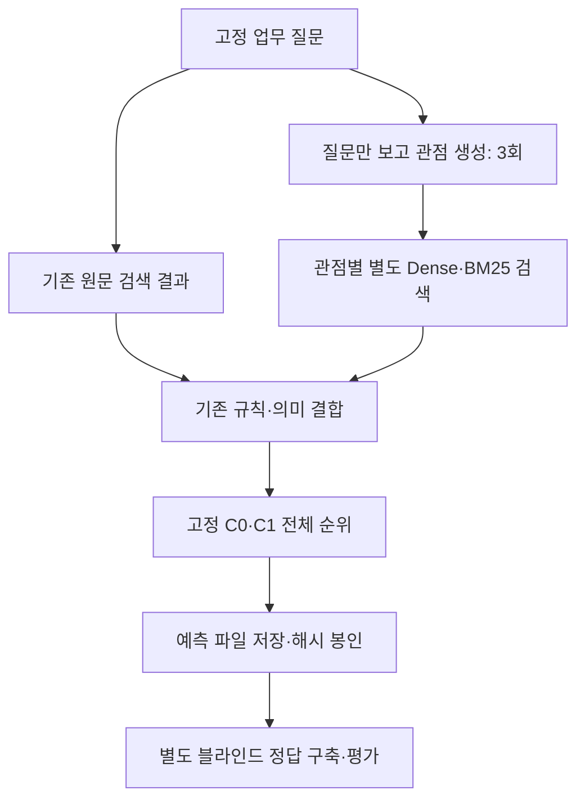

# AX 독립 Test 최종 평가 재개 결과 (2026-11-03)

## 1. 최종 결론

**이번 AI-Silver 점수 기준에서는 C1 다중관점의 F1@5 개선을 확인하지 못했습니다.**

C1 원문 19.05% → 다중관점 15.24% (-3.81%p). nDCG@10은 39.17% → 36.36% (-2.81%p)입니다.

**이 수치는 사람 정답으로 검증한 일반화 성능이 아닙니다.** Test 작성자가 사례를 먼저 봤고 기존 원문 예측과 일부 정답도 이미 검토됐습니다. 이번에는 원래 모델·가중치·정책을 그대로 유지하여 나머지 실험을 완료했습니다. 결과를 보고 모델이나 판정 기준을 튜닝하지 않았습니다.

## 2. 실제 수행과 정답 신뢰도

15질문×112사례=1,680쌍을 확인했습니다. 기존45건은 보존하고 미판정1,635건을 모두 평가했습니다. 첫 API 판정 v2는 1,680건 판정이었지만, 교차확인에서 의견이 갈린 새2건은 최종 보수 버전 v4에서 ABSTAIN으로 남겼습니다. 최종은 1,678건 판정·2건 보류, 전체112개가 판정된 질문14/15개입니다. 주 성능표는 최종v4 기준이며 최초v2도 따로 보존합니다.

평가자는 질문 원문과 사례 Problem·Task·Context만 봤습니다. 추천 모델 이름·순위·점수·기존 판정은 전달하지 않았고 질문을 섞지 않았습니다. 사례별 질문 ID·사례 ID·0~3점·근거·Task의 정확한 인용문을 검증했습니다. Problem에 필요한 작업이 나온다고 Task에서 실제 수행했다고 추측하지 않도록 지시했습니다.

기존 45건도 점수를 가린 별도 호출로 재검토했습니다. 등급 의견 차이는 20/45건, 관련/무관 경계의 차이는 4/45건입니다. 원래 점수를 다수결이나 새 모델 점수로 덮어쓰지 않았습니다. [불일치 상세](evaluation/audit45.json)와 [판정 민감도](evaluation/label_sensitivity.json)에 모두 남겼습니다.

새 판정은 **AI-Silver**입니다. `gpt-6-luna` 한 모델의 독립된 요청이며 다른 제공자 3종이나 사람 Gold가 아닙니다. 기존 평가와 대화·입력은 분리했지만, 사례 요약의 누락이나 같은 모델의 체계적인 오판까지 제거한 것은 아닙니다. Task 인용문 일치는 근거의 존재를 검사하며 기능적 관련성 판단의 정답성을 보장하지 않습니다.

## 3. 동결 모델과 실행 절차

이전 T1·T3 원문 순위와 점수를 그대로 재사용했습니다. 이번에 15질문×3회 관점을 생성했고 총 149개 관점을 각각 별도 경로로 검색했습니다. 관점에는 질문 원문을 덧붙이지 않았습니다. 모든 경로에서 112사례 전체 점수와 순위를 보존했습니다.



기존 결합: 규칙 점수=max(원문, 관점), 의미 점수=(원문+관점 최댓값)/2, 최종 규칙·의미 50:50입니다. 동적 동점 기준은 기존 F 조건의 관점별 Hybrid 평균이고 원문은 매핑 결합에 참여합니다. 원문 전용 동점 기준은 기존 원문 Hybrid입니다. 역사적 보조 RRF60을 새 알고리즘으로 도입한 것이 아닙니다. BGE-M3 모델·가중치·환경·코어 해시를 확인했습니다.

새 판정 요청에 앞서 모든 예측을 봉인했습니다. 추론 프로세스는 정답과 검토 파일 열기를 차단했고 네트워크도 차단했습니다. [예측 봉인](predictions/complete.json), [접근 기록](predictions/access_audit.json), [사전 등록](plan.json)을 확인합니다. 추가 판정은 별도 프로세스의 입력 전용 작업 목록에서 수행됐습니다.

## 4. 핵심 성능 비교

아래는 불확실한2건을 보류한 최종 AI-Silver v4에서 같은 코퍼스·질문·후보 수로 계산했습니다. 질문 안에서 3회 평균을 낸 뒤 질문마다 같은 무게를 주었습니다. 좋은 회차만 고르지 않았습니다. P는 추천 중 관련 비율, R은 관련 사례를 찾은 비율, F1은 둘의 균형, nDCG는 좋은 사례를 위에 놓은 정도입니다.

| 조건 | P@5 | R@5 | F1@5 | nDCG@10 |
|---|---:|---:|---:|---:|
| T1 C0 원문 | 4.29% | 50.00% | 19.05% | 39.17% |
| T2 C0 다중관점 | 3.33% | 43.33% | 15.24% | 34.68% |
| T3 C1 원문 | 4.29% | 50.00% | 19.05% | 39.17% |
| T4 C1 다중관점 | 3.33% | 43.33% | 15.24% | 36.36% |

| 조건 | P@10 | R@10 | F1@10 | P@20 | R@20 | F1@20 | nDCG@5 |
|---|---:|---:|---:|---:|---:|---:|---:|
| T1 C0 원문 | 2.14% | 50.00% | 10.61% | 1.79% | 90.00% | 9.44% | 38.92% |
| T2 C0 다중관점 | 1.90% | 46.67% | 9.49% | 1.55% | 76.67% | 8.17% | 33.63% |
| T3 C1 원문 | 2.14% | 50.00% | 10.61% | 1.79% | 90.00% | 9.44% | 38.92% |
| T4 C1 다중관점 | 1.90% | 46.67% | 9.49% | 1.79% | 90.00% | 9.44% | 34.96% |

**지표별 분모:** 전수 판정된 질문 중 비교하는 모든 조건에 값이 있는 같은 질문만 사용합니다. 관련 사례가 0개인 질문의 Recall/F1은 미정의이며, 전체 정답이 없으면 Recall/F1/nDCG를 계산하지 않습니다. 일부 Top-K만 모두 판정된 질문의 Precision은 질문별 결과에만 남깁니다. nDCG 이득은 `2^grade−1`입니다.

| 지표 | 평균에 포함한 질문 수 /15 |
|---|---:|
| Precision@5 | 14 |
| Recall@5 | 5 |
| F1@5 | 5 |
| nDCG@10 | 14 |

### 질문별 F1@5 / nDCG@10

| 질문 | T1 | T2 3회 평균 | T3 | T4 3회 평균 |
|---|---|---|---|---|
| HB001 | 미정의 / 58.90% | 미정의 / 51.51% | 미정의 / 58.90% | 미정의 / 51.51% |
| HB002 | 미정의 / 17.20% | 미정의 / 16.51% | 미정의 / 17.20% | 미정의 / 16.51% |
| HB003 | 미정의 / 46.93% | 미정의 / 46.93% | 미정의 / 46.93% | 미정의 / 46.93% |
| HB004 | 미정의 / 65.24% | 미정의 / 57.64% | 미정의 / 65.24% | 미정의 / 57.64% |
| HB005 | 0.00% / 40.48% | 0.00% / 13.22% | 0.00% / 40.48% | 0.00% / 36.80% |
| HB006 | 미정의 / 미정의 | 미정의 / 미정의 | 미정의 / 미정의 | 미정의 / 미정의 |
| HB007 | 33.33% / 58.79% | 33.33% / 56.86% | 33.33% / 58.79% | 33.33% / 56.86% |
| HB008 | 0.00% / 11.68% | 0.00% / 14.09% | 0.00% / 11.68% | 0.00% / 14.09% |
| HB009 | 33.33% / 76.98% | 33.33% / 76.90% | 33.33% / 76.98% | 33.33% / 76.90% |
| HB010 | 미정의 / 31.30% | 미정의 / 20.08% | 미정의 / 31.30% | 미정의 / 20.08% |
| HB011 | 미정의 / 51.87% | 미정의 / 52.67% | 미정의 / 51.87% | 미정의 / 52.67% |
| HB012 | 미정의 / 54.14% | 미정의 / 47.25% | 미정의 / 54.14% | 미정의 / 47.25% |
| HB013 | 미정의 / 10.21% | 미정의 / 16.55% | 미정의 / 10.21% | 미정의 / 16.55% |
| HB014 | 28.57% / 24.64% | 9.52% / 15.25% | 28.57% / 24.64% | 9.52% / 15.25% |
| HB015 | 미정의 / 0.00% | 미정의 / 0.00% | 미정의 / 0.00% | 미정의 / 0.00% |

### 원점수와 최종 보류 버전 구분

| 정답 버전 | C1 원문 F1@5 | C1 관점 F1@5 | C1 원문 nDCG@10 | C1 관점 nDCG@10 |
|---|---:|---:|---:|---:|
| 최초 API v2: 판정1680, F1분모6·nDCG분모15 | 20.04% | 16.87% | 39.07% | 36.48% |
| 최종 보수 v4: 판정1678·보류2, F1분모5·nDCG분모14 | 19.05% | 15.24% | 39.17% | 36.36% |

원점수 v2와 보류 v4는 같은 예측을 다른 판정 확실성으로 분석한 버전입니다. 서로 다른 버전의 절대 평균을 성능 변화라고 해석하지 않습니다. 두 버전 모두 원문보다 관점 평균이 낮았습니다.

### 첫 API 판정 v2에서 판정 차이를 바꿔 본 민감도 (원본 교체 아님)

| 가정 | C1 원문 F1@5 | C1 관점 F1@5 | C1 원문 nDCG@10 | C1 관점 nDCG@10 | F1 질문 수 |
|---|---:|---:|---:|---:|---:|
| audit45_alternative | 21.43% | 19.58% | 41.61% | 38.74% | 6 |
| binary_disagreements_abstain | 22.22% | 22.22% | 38.00% | 36.30% | 3 |
| all_new_grade2_as_auxiliary1 | 15.87% | 12.70% | 37.90% | 35.33% | 6 |
| 원문 근거 보수 검토: 불확실 1건 ABSTAIN 별도 v3 | 19.05% | 15.24% | 39.17% | 36.36% | 5 |

추가로 새 고득점 전부와 질문별 첫 0점 사례를 같은 기준의 별도 호출로 교차확인했습니다. 17건 중 등급 차이는 3건, 이진 경계 차이는 2건입니다. 같은 모델 반복이므로 완전한 독립 검증은 아닙니다.

NASA의 일반 영상 사건 감지를 포장 부속품 누락 검사에 적용할 수 있다는 HB006의 새 2점은 수행 범위가 불확실해, 성능을 보기 전 원문 검토에서 별도 보수 버전은 ABSTAIN으로 남겼습니다. 대화 맥락 기억 사례 HB004는 기존 1점을 보존했고 새 재검토의 2점으로 올리지 않았습니다. 원래 API2와 기존45건은 삭제하지 않았습니다. 보수 버전에서도 해당 질문의 전체 Recall/F1/nDCG를 계산하지 않습니다. 상세는 [source_cautious_metrics.json](evaluation/source_cautious_metrics.json)에 있습니다.

위 민감도는 최초 API v2를 기준으로 하며 주표는 보류2건을 적용한 v4입니다. 초기 원문보수검토 v3의 보류1건과 최종v4 보류2건은 같은 HB006 질문에 있어 주 평균 분모와 점수는 같습니다. 가정마다 불확실한 질문이 제외되어 분모가 바뀔 수 있습니다. 시나리오끼리 절대 점수를 단순 비교하지 말고, 각 시나리오 안의 원문·관점 차이를 봅니다. 불일치가 없다고 가정하거나 한쪽 점수를 정답으로 승인하지 않았습니다.

## 5. 성공·실패 사례와 관점 효과

| 비교 | Top-5 관련 진입/이탈 | Top-10 관련 진입/이탈 | Top-20 관련 진입/이탈 |
|---|---:|---:|---:|
| E1->E2 | 0 / 2 | 0 / 1 | 0 / 2 |
| E3->E4 | 0 / 2 | 0 / 1 | 0 / 0 |
| E2->E4 | 0 / 0 | 0 / 0 | 2 / 0 |

최종v4에서 C1 다중관점은 Top-5와Top-10에 새 관련 사례를 추가하지 못했고, 기존 관련 사례가 각각2회·1회 이탈했습니다. Top-20에서는 관련 사례 출입이 없었습니다.

위 수는 고유 사례 수가 아니라 질문·사례·회차의 출입 횟수입니다. 관련 사례가 들어오면서 다른 관련 사례가 밀리는 현상도 모두 남겼습니다. 보류된 사례를 무관 사례로 세지 않았습니다.

| C1 원문→관점 F1@5 변화 | 질문 ID |
|---|---|
| 개선 | 없음 |
| 악화 | HB014 |
| 동일 | HB005, HB007, HB008, HB009 |
| 미정의 | HB001, HB002, HB003, HB004, HB006, HB010, HB011, HB012, HB013, HB015 |

대표 사례: 은행 거래 대사는 C1 원문1위→관점1/1/1위로 유지됐습니다. 얼굴 익명화는1위→1/1/2위였습니다. 장애 신고의 실제 팀 라우팅 사례는65위→33/42/44위로 올라갔지만 여전히 Top-20 밖입니다. 반대로 같은 질문의 지원 행정 사례는4위→14/5/9위로 밀려 두 회차에서 Top-5를 벗어났습니다. 이 HB014 질문이 최종 F1@5 하락의 원인이며 다른 평가 가능 질문의 F1@5는 같았습니다. 순위가 조금 오른 것만으로 추천 성공이라고 세지 않았습니다.

모든 관련 사례의 원문·관점·회차별 순위와 규칙/의미 성분은 [relevant_case_diagnostics.json](evaluation/relevant_case_diagnostics.json)에 있습니다. 실제 업무 사례의 해석과 원문 근거 검토는 [품질 검토](quality_review.json)에 별도로 남깁니다.

## 6. 문장 임베딩과 개발 결과 비교

| C1 진단 | F1@5 | nDCG@10 |
|---|---:|---:|
| C1 원문 의미 중립 | 6.67% | 30.77% |
| T3 C1 원문 | 19.05% | 39.17% |
| C1 다중관점 의미 중립 | 13.33% | 29.22% |
| T4 C1 다중관점 | 15.24% | 36.36% |

C1과 C0는 이번 최종 Test에서 F1@5가 같았습니다. 다중관점 nDCG@10은 C1이 C0보다1.68%p 높지만 두 방식 모두 원문보다 낮았습니다. 149관점 중146개에서 기존18개 규칙의 지원 기능이 인식되지 않았습니다. 후보는 항상112개이므로 사례 누락을 후보 수 잘림으로 설명할 수 없고, 기능 추출·의미 비교·점수 결합의 순위 결정이 주된 진단 대상입니다. AI-Silver에서 관련 사례0개인 전수판정 질문도9개라 코퍼스 적용 범위의 한계가 큽니다. 검증된 현실의 관련 사례가 절대 없다는 뜻은 아닙니다.

중립화는 정규화 의미 성분을 0.5로 고정한 진단입니다. 필드 추출·규칙과 함께 움직이는 실제 파이프라인의 성분 비교이며 BGE-M3 단독 모델의 보편적 우월성을 입증하지 않습니다. 사례마다 기여 방향이 다를 수 있습니다.

| 자료 | C1 원문 F1@5 | C1 관점 F1@5 | C1 원문 nDCG@10 | C1 관점 nDCG@10 |
|---|---:|---:|---:|---:|
| 기존 개발 v2 | 23.95% | 46.07% | 41.08% | 53.85% |
| 후속 개발 v3 | 20.53% | 39.49% | 42.38% | 53.76% |
| 이번 Test | 19.05% | 15.24% | 39.17% | 36.36% |

개발 v2/v3도 평가 가능한 질문 수가 다르며, Test는 질문·판정 작성 방식과 난도가 다릅니다. Dev→Test의 절대 차이를 같은 문제의 성능 향상으로 해석하지 않습니다. Test 안에서 동일 조건의 모델을 비교한 차이가 핵심입니다. 동일 모델의 3회 생성은 독립된 45개 질문 표본이 아닙니다.

## 7. 비용·검증·보호

총 유료 HTTP 시도 228회, 입력 192,025토큰·출력 141,226토큰입니다. 사용량 단가 비용 $0.093397210, 보수적 사용량·실패 예약 합계 $0.094616125로 $2 이내입니다. 실제 결제 명세 금액이 아니라 기록된 사용량×단가 추정입니다.

사용자의 충분한 잔액 확인을 받아들였고 조직 비용 조회403을 생성 중단 사유로 삼지 않았습니다. 첫 실제 관점 생성 응답으로 인증과 모델 호출을 확인했습니다. [공식 모델 가격](https://developers.openai.com/api/docs/models/gpt-6-luna)을 실행 전에 확인했습니다. 호출별 토큰·응답 모델·예상 비용·누적 비용·실패 예약은 [api_ledger.json](api_ledger.json)에 있습니다. 응답을 받은 형식 오류만 1회 재요청하며 불확실한 타임아웃·HTTP 오류는 무작정 재호출하지 않습니다.

기존187개 검사와 신규14개를 함께 실행해 총201개가 통과했습니다. 교차확인 과정에서 기존45건과 신규 판정의 출처를 혼동한 임시 검토 메모를 실제 ID 조회로 바로잡았고, 기존45건을 보수 버전에서도 변경하지 못하도록 검사를 추가했습니다. 모델이나 원점수가 바뀐 것은 없습니다.

캐시 쓰기151,930토큰에는 일반 입력보다 높은 $0.125/백만 단가를 적용했습니다. 재사용한 호출 도우미의 초기 기본 계산은 이 추가분을 빠뜨렸으므로 원본 영수증은 보존하고 최종 호출별·누적 비용을 수정했습니다. 예산 제한에는 처음부터 모든 입력에 $0.125를 적용한 보수 금액을 사용했으므로 상한은 초과하지 않았습니다.

API 키는 환경 설정에서 읽었고 파일·로그·GitHub에 저장하지 않았습니다. 원본 Test 질문·45건 정답은 보존했고 원문 포함 요청/응답·관점·임베딩·새 전체 정답은 로컬 보호 경로에 저장했습니다. GitHub에는 해시, 새 판정 1,635건, 익명 질문ID별 전체 순위·점수·지표·품질 검토를 남겼습니다. [보호 검증](preservation.json), [자동 검사](tests.json)를 확인합니다.

## 8. 논문 활용과 다음 연구

이번 결과는 **고정된 추천 모델을 이미 일부 노출된 별도 질문 묶음에 적용한 AI-Silver 실험**의 근거로 사용할 수 있습니다. 데이터 작성 경위·기존 노출·동일 모델 평가·보류와 지표 분모·불일치 민감도·세 회 결과를 함께 공개해야 합니다. 사람 정답 기반의 완전 미사용 최종 독립 Test라고 쓰면 안 됩니다.

모델을 즉시 교체하거나 Test 점수에 맞춰 규칙·가중치를 고치지 않았습니다. 성공·실패 원인을 별도 Dev에서 연구하고, 중요한 관련성 경계를 사람 또는 독립 평가자가 확인한 뒤 더 강한 독립 검증을 권합니다. 성능이 나빠진 조건도 이번 결과에서 지우지 않았습니다.

## 9. GitHub와 재현

- 브랜치: `research/heldout-final-resume-20261103`
- 기준: `research/ax-stage4-stage5-independent-20261103`, `58acb10ed8e77f2689cbed1a57c715644a98a3ae`
- 예측 봉인 커밋: `09e64aa14844e3fa619322884647625d7c91c309`
- 최종 상태·결과 커밋: [final_status.json](final_status.json). 결과 커밋 ID는 후속 메타데이터 커밋으로 기록합니다.

```powershell
$env:PYTHONPATH="src;."
..\AX-prototype\.venv\Scripts\python.exe -m scripts.heldout_resume_api prepare
..\AX-prototype\.venv\Scripts\python.exe -m scripts.heldout_resume_api views --round 1
..\AX-prototype\.venv\Scripts\python.exe -m scripts.heldout_resume_api views --round 2
..\AX-prototype\.venv\Scripts\python.exe -m scripts.heldout_resume_api views --round 3
..\AX-prototype\.venv\Scripts\python.exe -m scripts.heldout_resume_api infer
# 예측 봉인 뒤 별도 프로세스
..\AX-prototype\.venv\Scripts\python.exe -m scripts.heldout_resume_api judgments
..\AX-prototype\.venv\Scripts\python.exe -m scripts.heldout_resume_api crosscheck
..\AX-prototype\.venv\Scripts\python.exe -m scripts.heldout_resume_evaluate
..\AX-prototype\.venv\Scripts\python.exe -m scripts.heldout_resume_finalize_labels
..\AX-prototype\.venv\Scripts\python.exe -m scripts.heldout_resume_final_analysis
```

기존 폴더가 있으면 prepare·infer·evaluate는 덮어쓰기를 거부합니다. API 성공 응답은 해시를 확인하고 재사용합니다. 무료 재현에는 저장된 원본·API 응답과 봉인 예측을 사용하며 원본 보호 경로는 plan.json에 있습니다. 새 유료 호출이 필요한 재실행은 별도 경로·예산으로 수행해야 합니다. 실제 2·3회 생성과 infer는 위 함수들을 호출한 동일한 입력 전용 실행 래퍼로 수행했습니다.
