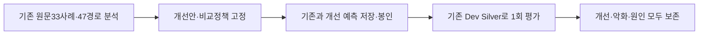

# 정밀 매핑 오류 원인 분석 및 개선 실험

2026-10-30 KST · research/mapping-improvement-20261030

**기능 인식은79→84개로 늘었지만, 주요 추천 성능은 개선되지 않았다. 기존 C를 교체하거나 교수님 시연에 반영하지 않는다.** 독립 Test가 아닌 기존 Dev AI-Silver 결과다. 결과 이후 설정을 바꾸지 않았다.

## ① 기존 문제

112사례중33개, 118원질문/관점중47경로에서 A규칙이기능을인식하지못했다. 하지만 UNKNOWN은 부적합 정답이 아니다. 미인식33개 모두 B의Task 의미비교는 가능했다. 모델 점수 산출 가능과 실제 기능 판단 정확성은 다른 개념이다.

기준은 runner `ba5308d1619e53ee8b1b6c223480a439f5adcf8b`이며 functional `be64f9c1`, semantic `715c4050`의 검증된코드와자료를포함한다. 교수시연 `dd281118`은4기존코어·설정이동일한것만확인했고시연코드수정/병합을하지않았다. 원격브랜치이름검사에서별도새통합브랜치는발견하지못했다. 실제확인범위는 `source_review.json` 참조.

사용자기준 A46.10/B38.76/C47.58%는기존동적관점 D_SINGLE F1@5다. SingleDense31.47%는원질문조건이므로, 둘의차이를관점만의효과로주장하면안된다. 아래원질문조건을따로제시한다.



## ② 원인

|33개 원인(보수적 AI분류)|개수|의미|
|---|---:|---|
|기존18기능범위밖|23|번역·송장재발송·하역·가격할인등을기존기능에억지로배정하지않음|
|기존기능의표현누락|5|동사produce1개, 대상data/website/transaction/self-introduction4개|
|행동불명확|4|자동화·지원·처리만으로상세수행업무미확정|
|압축전문어|1|예지보전등구체행동·대상별증거불충분|

이번33개에서부정/미래형보류0, 120자거리제한실패0, Task최대57자였다. 따라서현재33개실패를장문이나부정문오류로설명할근거는없다. 이는그구현이모든문장에서정확하다는뜻이아니다. 한국어·영어모두표현누락이있으며단순언어번역만의문제는아니다. 전수33개별Action/Object원문위치·Output·Context·진단은 [33개 표](audit/cases33.md), [원시근거](audit/cases33.json) 참조. 원출판물재검증이아닌기존구조화Task분석이며사람Gold가아니다.

47경로는31개가규칙상동작표현을찾지못했고16개는동작·대상이같은생산규칙으로연결되지않았다. 자료분산·의사결정지연·보안우려같은문제관점은실행동작을담지않을수있다. 분산상황만보고통합을수행한다고추정하는수정은하지않았다. [47개전수표](audit/paths47.md).

**가장 큰 평가 한계:** 미인식33개×10질문=330쌍의기존Silver는0점260/1점66/2점4이며3점이상은0개다. 따라서이Dev로는미인식33개를인식했을때의관련사례발견향상을충분히검증할수없다. 새로인식한5개도50쌍모두0~1점이었다. 다른질문에도쓸모없다는뜻은아니다. [정량근거](dataset_limits.json).

기존 B에서는 `during`, `warning`, `advertising`처럼-ing명사/전치사도Action으로뽑힌실제필드가있었다. `Review merchant websites during onboarding`의Action은Review/during/onboarding이고,이미지생성사례에서는Produce를놓치고advertising을Action으로뽑았다. 단순잔여문자열Object도주어·조건을포함한다. 따라서필드가존재한다고정확한의미역할로보면안된다. 모든실제B필드는cases33.json에보존했다.

오류는미인식뿐아니라이미인식한모호한동사에도있었다. 이메일·첨부문서의핵심과후속조치를정리하는Q2의관점‘첨부문서검토부담’이직원신원조회보고서검증과운임청구서감사를규칙4점으로올렸다. ‘읽고파악하는검토’와‘조건충족검증’이같은validate_record로연결됐다. Q2첫회차직원보고서사례는A3위/B9위/C4위,운임감사는A5위/B51위/C6위다. 두사례의Silver는0이다. 원질문규칙은각1점인데최고관점4점이최종순위를끌어올린다. 이는추출/정밀매핑의다의어와최고관점집계의결합문제이며검색누락문제는아니다. 관점표현선택도영향을주지만이자료만으로생성단계오류라고확정하지않는다. [세부추적](case_traces.json).

전체112개가모든후보풀에존재하므로이번분석에서관련사례의TopK탈락은후보생성실패와구분했다. D_SINGLE의기존A Top5중Silver관련기준미달116건,관련사례Top5밖20건,A/B20위이상차이1625건,C가A보다상승1587/하락1556건을모두보존했다. 질문×회차×사례사건이며진단표지가겹치므로오류개수나고유사례수로합산하지않는다. 0점과1~2점부분관련도구분한다. [전체오류기록](experiment/evaluation/old_error_analysis.json).

## ③ 개선 방법

기존18기능수를유지하면서표현/영어단어경계를보완한A2, 한쪽규칙미인식시기존Task cosine을사용하는B2를별도구현했다. C_R은규칙만,C_S는의미만,C_U는규칙쌍전부미인식일때의불이익만바꾼다. C_ALL은이세변경의사전고정조합이다. 자세한식·이유는 [평가전설계](design.md)와 `configs/mapping_improvement_20261030.json`에있다.

설계/코드고정 `97e3af27` → 예측봉인 `fa993183` → Dev평가순서다. 이미과거Dev결과를아는상황이므로완전한맹검사전등록은아니다. 정답에맞춘사례ID규칙·가중치탐색·결과후재설계는하지않았다. 모델가중치/임베딩은그대로재사용했고새추론/학습/API는0회다.

Problem이나Context를실제Task수행근거로올리지않고, 명시되지않은Output은UNKNOWN으로남긴다. 규칙output_type은기능분류명이지실제산출물검증결과가아니다. 새로인식한5개는다음과같다. 이는원문기반AI검토와인용검사까지이며사람정확도검증은아니다.

|사례|Task|추가로 인식한 기능|실제 출력 근거 상태|
|---|---|---|---|
|AXV2C_0074_02|Review merchant websites during onboarding|validate_record|실제Output별도명시없음|
|AXV2H_0078_01|사내 관리데이터 자연어 조회|retrieve_knowledge|실제Output별도명시없음|
|AXV2N_0103|Reconcile bank transactions at month end|validate_record|실제Output별도명시없음|
|AXV2N_0115|Produce approved lifestyle images for product advertising|generate_content|생성되는이미지는원문명시|
|AXV2P2_0100_01|Screen and assess applicant self-introductions|validate_record|실제Output별도명시없음|

나머지28개는원래범위밖23개/행동불명확4개/압축전문어1개여서보류한다. 질문·관점인식71/118은변화없고기존인식79사례를잃지않았다.

## ④ 실험 결과

동일112사례, 원질문10+기존108관점, 동일80풀, 기존Single/3View백본, 전체112순위, 기존집계·동점·반복을유지했다. 기존0~4점Silver 중앙값>=3,양성18쌍. P는10질문,R/F1은양성6질문평균,무양성Q2/Q5/Q7/Q9는R/F1결측이다. 무양성은완전판정된0양성이며미평가와다르다. 동적3회는질문별평균후Macro다.

다음은주조건D_SINGLE(단,SingleDense행만원질문참고), 단위%다.

|방식|P@5|R@5|F1@5|F1@10|F1@20|
|---|---:|---:|---:|---:|---:|
|Single Dense 원질문(참고)|16.00|60.56|31.47|28.11|19.92|
|기존 A|22.67|88.89|46.10|34.01|23.25|
|A2 표현 보완|22.67|88.89|46.10|34.01|23.25|
|기존 B|19.33|77.78|38.76|31.44|20.69|
|B2 Task 대체|19.33|77.78|38.76|30.33|20.32|
|기존 C|24.00|90.00|47.58|35.67|23.25|
|C_R 규칙만 변경|24.00|90.00|47.58|35.67|23.25|
|C_S 의미만 변경|23.33|89.44|46.84|35.12|23.25|
|C_U 미인식 보정|22.00|88.33|45.36|34.01|23.25|
|C_ALL 고정 조합|22.00|88.33|45.36|34.56|23.25|

주조건F1@5는A/B동일,C_R동일,C_S -0.74%p,C_U/C_ALL -2.22%p다. B2의F1@10은31.44→30.33,F1@20은20.69→20.32%로낮아졌다. 원질문만쓰는B2의F1@20은22.14→23.25%(+1.11%p)라는부분개선이있었지만주조건전체개선으로승격하지않는다.

|원질문만|F1@5|F1@10|F1@20|
|---|---:|---:|---:|
|A0|45.36|32.34|23.25|
|A2|45.36|32.34|23.25|
|B0|37.02|28.11|22.14|
|B2|37.02|28.11|23.25|
|C0|47.58|34.01|23.25|
|C_R|47.58|34.01|23.25|
|C_S|47.58|34.01|23.25|
|C_U|45.36|30.67|23.25|
|C_ALL|45.36|32.34|23.25|

3View조건도생략하지않고 [전조건P/R/F1@5/10/20](experiment/evaluation/macro_metrics.csv), [질문별평균](experiment/evaluation/query_mean_metrics.csv), [반복별수치](experiment/evaluation/per_repeat_metrics.csv)에모두있다. [전112후보순위](experiment/rankings.json), [관점별순위](experiment/branch_rankings.json), [점수성분](experiment/score_details.json), [모든질문-사례순위변화](experiment/evaluation/rank_changes.csv)도보존했다.

**발견·손실사례:** 원질문B2에서Q1의‘결제기술문의검색·답변’(AXV2H_0071_01)이Top20에새로들어왔다. 반면D_SINGLE B2의Q1첫회차Top10에서는은행질의응답(AXV2C_0092_01)을얻었지만HR정책질의응답2개와웹사이트FAQ답변1개를잃었다. Top20에서도일부손실이있고다른회차에서는저복잡도티켓응답을추가발견했다. 좋은사례만고르지않고 [GAIN/LOSS전수](experiment/evaluation/gain_loss.json)에K별/회차별보존했다.

C_U의Q1첫회차에서미인식‘보험청구처리질문조사’(AXV2N_0133)는기존C0.3880→0.7760으로높아져3위에들어왔다. 이는Silver2점인부분관련이며3점이상관련기준미달이다. 그결과기존‘고객문의자율응답’이5→6위로밀렸다. C_ALL에서도해당보험사례가3위에들어와다른관련사례를밀었다. 미인식을0점으로취급하지않는것은타당한문제제기지만,기존의서로다른점수척도를그대로보정하면무조건개선되는것은아니다. [계산항과순위](case_traces.json).

다음표는전112후보의순위이동사건수다. 관련>=3과명시0점을분리하고,부분관련1~2점은verification.json에따로있다. 순위상승건수만으로성능향상을판단하면안된다.

|D_SINGLE 방식|관련↑|관련↓|관련동일|0점↑|0점↓|0점동일|
|---|---:|---:|---:|---:|---:|---:|
|A2_D_SINGLE|0|4|50|22|677|1554|
|B2_D_SINGLE|17|8|29|1470|679|104|
|C_R_D_SINGLE|0|3|51|22|777|1454|
|C_S_D_SINGLE|3|6|45|1268|632|353|
|C_U_D_SINGLE|0|30|24|762|1299|192|
|C_ALL_D_SINGLE|3|27|24|735|1471|47|

**검증:** 기존108+신규19=127자동검사통과. 기존A/B/C 전체112순위240개정확재현,730개순위(새/기존720+Dense10)검사,별도Fraction수식으로Macro333수치검산,798원문인용위치검사,새예측6개파일재실행SHA완전일치. 의미판단정확도나일반화검증과는다르다. [검증JSON](verification.json), [테스트로그](pytest.txt). 키읽기/유료API/독립Test열람/새모델추론0,추가비용$0.

## ⑤ 연구적 의미

인식률은79/112(70.54%)→84/112(75.00%),미인식33개중5개(15.15%)를복구했다. 하지만추천F1상승으로이어지지않았다. 논문에는‘규칙커버리지증가≠추천적합성개선’,‘미인식점수보정의부작용’,‘검토/검증다의어와관점최대집계의실패경로’를보여주는부정결과절제실험으로사용할수있다. 새모델이우수하다거나다중관점이언제나유리하다고쓸수없다.

이Dev에서미인식33개의양성이0개이므로그사례들의기능보완효용자체를판단할평가질문이다양하지않다. 사람검토없음,동일모델3회Silver편향,기존Dev반복사용,원출판물재검증없음,기존관점/모델고정이라는한계를함께적어야한다. 이번실험결과로정답을고치거나독립Test를튜닝에사용하지않는다.

## ⑥ 다음 연구

이번개선안을기존모델/시연/독립Test실행기에반영하지않는다. 다음우선과제는미인식수늘리기보다‘읽기/요약을위한검토’와‘오류/준수검증’을구분하는판단기준및원문기능의사람검토다. 새로운독립자료를작성할때는현재Dev에서빠진실제업무기능도평가할수있는지점검하되,이번에Work B질문/정답을열거나새질문을만들지는않았다. 추가방식은새설계·별도사전검증으로진행하며이번Dev결과를보고파라미터를재조정하지않는다.

## 재현 방법과 파일 보호

기존연구venv,requirements-v25-dev프로필,로컬BGE-M3모델이필요하다. 기존preregistration과핵심패키지버전/모델파일해시를검증하고캐시된벡터·성분을그대로재사용한다. 새다운로드나API는없다. 상태/환경/해시는experiment/preregistration.json에있다.

```powershell
$env:PYTHONPATH='src;.'
$env:PYTHONIOENCODING='utf-8'
$env:PYTHONDONTWRITEBYTECODE='1'
$py='../AX-prototype/.venv/Scripts/python.exe'
# 존재하지않는새경로를사용;기존출력을덮지않음
& $py -m scripts.mapping_improvement_audit --output '../AX-audit-repro-new'
& $py -m scripts.mapping_improvement_run freeze --output '../AX-mapping-repro-new'
& $py -m scripts.mapping_improvement_run predict --output '../AX-mapping-repro-new'
& $py -m scripts.mapping_improvement_run evaluate --output '../AX-mapping-repro-new'
& $py -m pytest -p no:cacheprovider tests/test_mapping_improvement.py -q
```

실패시failed.json을남기고자동재호출하지않는다. 평가출력이이미있으면거부한다. 기존보호assert를삭제하거나우회하지않고별도어댑터에서과거기준일치검사/새동결을한다. 기존A/B/C·설정·112원본·정답·시연은변경없음. 기존파일의변경은새파일줄바꿈을고정하는4개.gitattributes메타데이터추가뿐이다.
