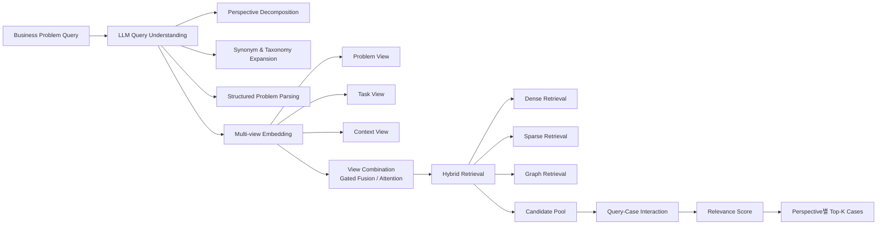
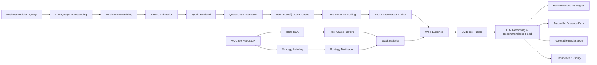

# 연구계획서

> **GENESIS AI**  
> 본 문서는 현재 연구계획서의 Markdown 정리본이다.  > 연구의 기준 구조는 교수 피드백에 첨부된 **LLM-Augmented Multi-View Neural Search Model for AX Cases**와 **FAME-AX + LLM** 아키텍처이며, 큰 흐름을 임의로 변경하지 않고 세부 구현을 단계별 효과 검증으로 확정한다.

## 기본 정보

| 항목 | 내용 |
|---|---|
| 키워드 | AX, Multi-Perspective, Multi-view Embedding, Gated Fusion, Hybrid Retrieval, Query-Case Interaction, Factor Anchor, Wald Evidence, Strategy Recommendation |
| 성명 | 김정훈 |
| 착수 예정일 | 2026년 9월 1일 |
| 완료 예정일 | 2026년 12월 1일 |
| 연구제목 | **기업 업무문제 기반 다중관점 AX 사례 검색·전략 추천 모델 연구: LLM-Augmented Multi-View Neural Search와 Factor-Anchored Evidence를 중심으로** |

---

## 1. 연구 배경 및 범위

본 연구는 기업 사용자가 자연어로 설명한 업무문제에 대해 관련 AX 사례를 검색하고, 실제 사례 근거를 바탕으로 AX Strategy를 추천하는 과정을 대상으로 한다. 기존의 단일 질의 기반 검색은 **BM25와 같은 어휘 기반 검색**과 **Dense Retrieval과 같은 임베딩 기반 검색** 모두에서, 업무문제에 내재된 복수의 관점을 명시적으로 분리·보존하지 않을 경우 일부 관점에 대응하는 AX 사례가 후보군에서 누락될 수 있다. 특히 초기 Retrieval 단계에서 누락된 사례는 후속 Reranking만으로 회복하기 어렵다. 이에 본 연구는 업무문제를 다중관점으로 분해하고, 관점별 검색 결과를 보존하여 관련 사례의 검색 범위와 다양성을 개선하는 방법을 검토한다.

선행연구는 기업 문제와 AI 활용기회를 연결하는 연구[1][2][3], AI Use Case의 가치·실현가능성·위험을 평가하는 연구[4], 과거 비즈니스 사례를 현재 문제 해결에 재사용하는 추천 연구[5], 하나의 문서를 복수 의미표현으로 학습하는 Multi-view Dense Retrieval 연구[8] 등으로 구분할 수 있다. 본 연구는 이러한 연구를 참고하되, 교수 피드백에서 제안된 신규 검색·추천 모델 구조를 기준으로 기업 AX 사례 검색에서 다중관점 유지, Multi-view 표현, 학습형 Query-Case 상호작용, Root Cause 기반 Factor Anchor와 통계 Evidence를 하나의 모델 안에서 연결하는 방법을 검토한다.

이에 본 연구는 교수 피드백에 첨부된 두 아키텍처를 연구의 기준 구조로 사용한다.

1. **LLM-Augmented Multi-View Neural Search Model for AX Cases**
   - LLM Multi-Perspective Decomposition
   - Multi-View Embedding & Fusion
   - Dense/Sparse Candidate Retrieval
   - Query-Case Interaction Neural Network
   - Perspective별 Top-K 사례 검색

2. **FAME-AX + LLM**
   - Root Cause Factor Anchor
   - Wald Evidence
   - Evidence Fusion
   - LLM Reasoning & Recommendation Head
   - 추천 전략과 추적 가능한 근거 경로 출력

아키텍처의 큰 흐름은 변경하지 않고, 세부 구현은 단계별 효과 검증을 통해 확정한다.

---

## 2. 연구 목적 및 연구 질문

본 연구의 목적은 하나의 기업 업무문제를 LLM으로 복수 Perspective로 분해하고, Problem·Task·Context 기반 Multi-view 표현과 학습형 Neural Retrieval을 이용해 관련 AX 사례를 관점별로 검색한 뒤, Root Cause Factor와 Wald 통계근거를 Evidence로 결합하여 관점별 AX Strategy를 설명 가능하게 추천하는 모델을 설계·검증하는 것이다.

- **RQ1**: LLM으로 생성한 복수 문제관점을 Retrieval 단계까지 유지하는 검색모델이 단일질의 검색 또는 GPT-only 방식보다 관련 AX 사례의 Recall@K를 향상시키는가?
- **RQ2**: Problem·Task·Context를 분리한 Multi-view Embedding과 Gated Fusion, Hybrid Retrieval, Query-Case Interaction이 단일 Dense 표현 중심 검색보다 관점별 관련 사례 검색 품질을 향상시키는가?
- **RQ3**: 검색된 사례의 Evidence를 Root Cause Factor Anchor와 Wald 통계근거에 연결하고 Evidence Fusion으로 결합할 때, 관련 사례로부터 발견되는 AX Strategy Coverage와 추천 근거의 추적성이 향상되는가?
- **RQ4**: FAME-AX + LLM 구조가 Perspective별 Branch를 유지한 상태에서 Recommended Strategies, Traceable Evidence Path, Actionable Explanation, Confidence/Priority를 일관된 근거 기반 출력으로 제공할 수 있는가?

---

## 3. 데이터 구성

NIPA, NIA, KOSA 등 공공기관의 AI·AX 사례집과 기업 공개 고객사례를 중심으로 약 100~150건의 AX 사례를 수집한다. 「실전 AX 리포트」 등 관련 서적과 보고서는 사례 분류, AX 단계 및 성공요인 정의를 위한 참고자료로 활용한다.

AX Case Repository는 검색·추천과 Evidence 구성을 위해 **Problem View**와 **Solution View**를 분리하여 구조화한다.

- 검색용 핵심 필드
  - Business Problem
  - AX Target/Task
  - Business Context/Condition
- Multi-view Embedding
  - Problem View
  - Task View
  - Context View
- Blind RCA
  - Problem View를 입력으로 Root Cause Factors(F01, F02, …) 구축
- Strategy Labeling
  - Solution View의 implemented strategy와 outcome 활용
- Wald Statistics
  - Root Cause와 Strategy를 결합하여 β, OR, p-value 계산
- Retrieval Index
  - 사례 임베딩과 필요한 관계정보를 Case/Graph Embedding Index로 구축

연구 초기에는 20~30건의 Pilot/Development Set을 이용해 Problem·Task·Context 구조화 기준, Root Cause Factor 체계, Strategy Multi-label 체계를 정리한 뒤 Main Dataset에 고정 적용한다. 사용자 Query는 업무문제를 기본 입력으로 하고 목표와 업무 환경/조건은 선택 입력으로 구성한다. 원문에 없는 내용은 임의로 보완하지 않으며, 세부 라벨링 기준과 정답 데이터 구축 절차는 Pilot 검증을 통해 확정한다.

---

## 4. 연구 방법 및 모델 결합 구조

본 연구의 모델 구조는 교수 피드백에 첨부된 다음 두 아키텍처를 기준으로 한다.

1. **LLM-Augmented Multi-View Neural Search Model for AX Cases**
2. **FAME-AX + LLM**

검색 코어 모델은 다중관점 생성, Multi-view 표현, Candidate Retrieval, Neural Interaction을 담당하고, 전체 모델은 여기에 Case Evidence Pooling, Factor Anchor, Wald Evidence, Evidence Fusion, LLM Recommendation Head를 연결한다.

각 구성요소의 채택 여부와 세부 하이퍼파라미터는 아키텍처를 임의 변경하는 방식이 아니라 **단계별 실험으로 효과를 검증하면서 확정**한다.

### 4.1 전체 단계

| 단계 | 입력 | 처리 모델/방법 | 주요 출력 |
|---|---|---|---|
| LLM Query Understanding | Business Problem Query | Perspective Decomposition + Synonym/Taxonomy Expansion + Structured Parsing | P1…Pk Perspective Branch |
| Multi-view Embedding | Perspective + AX Case | Problem / Task / Context View + Shared Text Encoder + Projection | View별 Embedding |
| View Combination | Problem/Task/Context Embedding | Gated Fusion / Attention | Branch Embedding |
| Hybrid Retrieval | Branch Embedding + Case Index | Dense + Sparse + Graph Retrieval, Candidate Union Top-K | Candidate Pool |
| Query-Case Interaction | q_k + c_i | `[q,c,q⊙c,|q-c|] → MLP → Relevance Score` | Perspective별 Top-K Cases |
| Case Evidence Pooling | Top-K Retrieved Cases | Attention Pooling | Case Evidence |
| Factor Anchor | Case Evidence + Root Cause Factors | Blind RCA 기반 Factor Anchor(F01…) | Factor Embedding / Anchor |
| Evidence Fusion | Branch + Case + Factor + Wald | Evidence Fusion Layer | Integrated Evidence |
| Recommendation Head | Integrated Evidence | Evidence-grounded Reasoning + Strategy Generation + Rationale | Recommended Strategies + Explanation |
| Offline Training/Evidence | AX Case Repository | Blind RCA + Strategy Labeling + Wald Statistics + Case/Graph Index | Factors / β·OR·p-value / Retrieval Index |

### 4.2 Search Core Architecture

### 4.3 FAME-AX + LLM Architecture

### 4.4 단계별 설명

#### 1) LLM Query Understanding

사용자 Business Problem Query를 Instruction-tuned LLM이 Perspective Decomposition, Synonym & Taxonomy Expansion, Structured Problem Parsing으로 처리한다. 이 단계에서 P1…Pk의 복수 문제관점을 생성하되, 해결전략을 미리 정하지 않고 이후 Retrieval Branch의 입력으로 유지한다.

#### 2) Multi-view Embedding Layer

각 Perspective와 AX 사례를 Problem View, Task View, Context View로 분리하여 Shared Text Encoder와 Projection을 통해 각 의미표현을 생성한다. 검색 코어 아키텍처는 각 View를 별도로 보존하고, Full FAME-AX 구조에서는 `[B, R, 3, 256]` 형태의 Multi-view 표현으로 연결한다.

#### 3) View Combination Layer

Problem·Task·Context 표현을 Gated Fusion 또는 Attention으로 결합하여 Perspective별 Branch Embedding을 생성한다. 중요도는 고정 규칙으로 지정하기보다 학습 과정에서 검색·추천 목적에 맞게 조정되도록 한다.

#### 4) Hybrid Retrieval Layer

검색 코어 모델에서는 Dense Retrieval(ANN/Vector DB)과 Sparse Retrieval(BM25/SPLADE) 결과를 Candidate Union으로 결합하고, FAME-AX 전체 아키텍처에서는 Graph Retrieval을 추가한 Hybrid Retrieval을 사용한다. Retrieval 단계의 역할은 최종 순위를 결정하는 것이 아니라 관련 가능성이 있는 Candidate Pool을 확보하는 것이다.

#### 5) Query-Case Interaction Layer

각 Perspective `q_k`와 Candidate Case `c_i`를 `[q_k, c_i, q_k ⊙ c_i, |q_k-c_i|]` 형태로 결합하고 MLP를 통과시켜 Relevance Score `s(q_k,c_i)`를 산출한다. 이 점수로 Perspective별 Top-K 사례를 선택하며, 서로 다른 Perspective의 결과를 하나의 전역 순위로 조기 통합하지 않는다.

#### 6) Case Evidence Pooling & Factor Anchor

선택된 사례들의 관련 근거를 Attention Pooling으로 집약하고, Offline에서 Problem View만으로 수행한 Blind RCA 결과인 Root Cause Factors(F01, F02, F03, …)에 연결한다. Root Cause는 사례 간 공통 기준점인 Factor Anchor로 사용한다.

#### 7) Wald Evidence

Offline에서 Solution View의 Strategy Multi-label과 Root Cause Factors를 이용해 Factor ↔ Strategy 관계의 Wald Statistics(β, OR, p-value)를 구성한다. Wald는 추천을 직접 결정하는 모듈이 아니라 Evidence Fusion에 제공되는 통계적 근거로 사용하며, 인과관계가 아닌 연관성으로 해석한다.

#### 8) Evidence Fusion Layer

Branch Embedding, Case Evidence, Factor Embedding, Wald Evidence를 결합하여 관점별 통합 Evidence Representation을 생성한다. 이 단계는 검색 전 Problem·Task·Context를 결합하는 View Combination과 구분되며, 검색 이후 추천을 위한 근거 통합 역할을 수행한다.

#### 9) LLM Reasoning & Recommendation Head

통합 Evidence를 기반으로 Evidence-grounded Reasoning, Strategy Generation, Natural-language Rationale을 수행한다. 최종 출력은 Recommended Strategies, Traceable Evidence Path, Actionable Explanation, Confidence/Priority로 구성하며, Strategy는 multi-label로 다룬다.

#### 10) Training Objectives

검색 코어 모델은 Ranking Loss, Multi-View Diversity Loss, In-batch Contrastive Loss를 사용하며 다음 형태를 기준으로 한다.

`L_total = L_rank + λ1 L_div + λ2 L_ctr`

FAME-AX 전체 모델은 Strategy Loss, Ranking Loss, Factor Loss, Diversity Loss를 결합한 다음 형태를 기준으로 한다.

`L_total = L_strategy + λ1 L_rank + λ2 L_factor + λ3 L_div`

두 Loss 구성은 각각 Search Model과 Full Model 단계에서 검증하고 최종 조합을 확정한다.

#### Dike 해석 원칙

교수 추가 피드백에 따라 Dike는 별도 후단 모듈을 새로 추가하기보다 **“판별” 개념을 학습 목적과 최종 판단 기준에 반영하는 방향**으로 해석한다. 다만 제안 아키텍처에 명시되지 않은 별도의 Dike Loss 수식은 임의로 정의하지 않고, 기존 Loss 구조와 단계별 실험 결과를 기준으로 구체화한다.

---

## 5. 평가 지표 및 유효성 판단

### 핵심 성능평가

최종 검증의 중심은 관련 AX 사례 **Recall@K**와 **Strategy Coverage@K**로 둔다.

- Recall@K: Gold Relevant Cases 중 모델이 Top-K에서 회수한 비율
- Strategy Coverage@K: Gold Strategy Set 중 추천 사례를 통해 발견한 전략 범위

Gold Label은 제안모델의 검색점수·추천결과와 분리된 독립 절차로 구축하며 세부 기준은 Pilot에서 확정한다.

### Baseline 비교

제안모델은 다음을 기본 비교대상으로 둔다.

1. 원질의 기반 단일 Dense Retrieval
2. GPT-only 사례 판단/추천

동일한 Search Budget/출력 건수 조건에서 비교하여 단순히 더 많은 후보를 검색했기 때문에 Recall이 증가하는 효과를 통제한다.

### 단계별 Ablation

교수 아키텍처를 기준으로 다음 구성요소의 효과를 단계적으로 확인한다.

- Multi-Perspective
- Multi-view Embedding
- View Combination
- Hybrid Retrieval
- Query-Case Interaction
- Factor Anchor / Wald Evidence
- Evidence Fusion / Recommendation Head

효과가 확인되지 않는 세부구현은 아키텍처의 목적을 유지하는 범위에서 수정하며, 변경 근거와 결과를 기록한다.

### Evidence 평가

최종 추천이 다음 경로로 역추적 가능한지 확인한다.

`Perspective → Retrieved Cases → Root Cause Factor → Wald Evidence → Recommended Strategy`

Actionable Explanation이 실제 Evidence에 근거하는지 검토한다. Wald 결과는 회귀계수 방향, Odds Ratio, p-value 또는 신뢰구간을 통해 보조적으로 해석하며 인과관계로 주장하지 않는다.

### 유효성 판단 원칙

단일 성능지표만으로 결론을 내리지 않고, Search Model의 Recall 개선과 Full FAME-AX의 Strategy Coverage 및 근거 추적성을 함께 평가한다. 특히 교수 피드백에서 제시된 **“단일질의/GPT-only 대비 다중관점 검색·추천의 실질적 개선”**을 최종 유효성 판단의 중심으로 둔다.

---

## 6. 기대 효과 및 연구 기여

첫째, 기업 업무문제를 하나의 Query로 고정하지 않고 복수 Perspective로 분해하여 Retrieval 단계까지 Branch를 유지하는 LLM-Augmented Multi-View Neural Search 모델을 제안한다.

둘째, Problem·Task·Context의 분리 표현과 Gated Fusion, Hybrid Retrieval, Query-Case Interaction을 결합하여 단일 임베딩 검색의 Recall 한계를 개선하는지 검증한다.

셋째, 검색된 사례 Evidence를 Root Cause Factor Anchor와 Wald Statistics에 연결하고 Evidence Fusion을 통해 Strategy 추천으로 확장하는 FAME-AX + LLM 구조를 검증한다.

넷째, Recommended Strategies뿐 아니라 Traceable Evidence Path와 Actionable Explanation을 함께 제공하여 검색·추천 결과의 설명가능성과 활용성을 높인다.

본 연구는 교수 제안 아키텍처를 최종 기준으로 하되, 초안 구조의 각 구성요소가 실제로 효과가 있는지를 단계별로 검증하여 모델을 정교화한다. 후속 연구에서는 Perspective별 Strategy와 Evidence를 기반으로 대화형 AX 의사결정, PoC 범위·로드맵 생성, 공수·MM 및 비용 추정, 전문 Agent 협업 기반 AX 실행계획 지원으로 확장할 수 있다.

---

## 참고연구

1. Hofmann et al. (2020). *Developing Purposeful AI Use Cases - A Structured Method and Its Application in Project Management*. WI 2020.
2. Hofmann et al. (2026). *Identifying artificial intelligence use cases: toward a method that facilitates garbage can innovation processes*. Information & Management, 63(1), 104261.
3. Choi et al. (2026). *Leveraging cross-domain knowledge alignment for AI transformation*. Applied Soft Computing, 202, 115746.
4. Bodendorf, F. (2025). *A data-driven use case planning and assessment approach for AI portfolio management*. Electronic Markets, 35(1), 22.
5. Pande et al. (2022). *New Hybrid Techniques for Business Recommender Systems*. Applied Sciences, 12(10), 4804.
6. Agresti, A. (2018). *An Introduction to Categorical Data Analysis* (3rd ed.). Wiley. (Logistic regression/Wald 검정 참고).
7. 박주혜 외 (2026). *실전 AX 리포트*. 한빛미디어. (AX 사례 분류·추진단계·성공요인 참고).
8. Zhang, S., Liang, Y., Gong, M., Jiang, D., & Duan, N. (2022). *Multi-View Document Representation Learning for Open-Domain Dense Retrieval*. ACL 2022, 5990-6000.
9. Fisher, A., Rudin, C., & Dominici, F. (2019). *All Models are Wrong, but Many are Useful: Learning a Variable’s Importance by Studying an Entire Class of Prediction Models Simultaneously*. Journal of Machine Learning Research, 20, 1-81.
