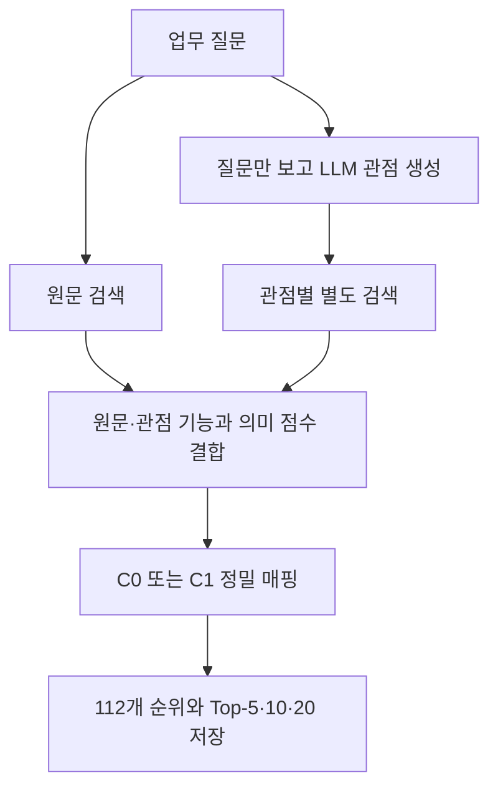

# AX 신규 검증: 1~3단계 통합 결과 (2026-11-03)

## 1. 최종 결론

**이번 AI-Silver 검증에서는 다중관점 검색이 개선됐습니다. 다만 사람 검증이나 독립 Test에서 입증된 결과는 아닙니다.** C1 원문 단독과 C1 다중관점의 F1@5는 23.95% → 46.07%로 +22.12%p (상대 +92.4%)입니다. nDCG@10은 41.08% → 53.85%로 +12.77%p (상대 +31.1%)입니다.

이는 C1만의 효과가 아닙니다. C0 다중관점도 F1@5 43.04%로 높아졌습니다. 원문 단독에서는 C0와 C1의 F1@5가 같았습니다. C1 다중관점은 실험 후보로 유지하되 기존 모델·시연 프로그램을 교체하지 않습니다.

## 2. 단계별 결과

| 단계 | 실제 수행 | 결과 |
|---|---|---|
| 1 정답 재검토 | 기존 19쌍을 질문별 10회 API 요청으로 블라인드 재검토하고 원문으로 재판정 | 기존 보류 5건 중 3건 판정, 2건 보류 유지. 별도 v2 저장 |
| 2 원문 단독 재검증 | 기존 고정 순위로 v2 평가, 별도 새 임베딩 계산으로 재현 | 30개 순위·3,360개 점수 완전 일치. 8개 질문의 전체 정답 확보 |
| 3 다중관점 검증 | 10질문 × 3회 생성, 총 107관점 각각 112사례 검색 | 4조건 비교와 의미 점수 중립화 진단 완료 |

정답은 0~3점이며 2점 이상을 관련 사례로 셉니다. v2 1,120쌍 중 1,118쌍 판정·2쌍 보류입니다. 등급 분포는 0점 932, 1점 129, 2점 53, 3점 4입니다. 원래 19건 밖의 1,101개 판정은 그대로 두었습니다.

**검증 한계:** API 재검토에는 기존 점수·추천 순위·C0/C1 이름을 주지 않았습니다. 그러나 같은 제공자의 AI이고, 최종 원문 재판정은 기존 작업 AI가 했습니다. 전체 정답표의 독립 검증이나 Human-Gold라고 부르지 않습니다. 사람이 확인할 목록은 [human_confirmation.json](stage1/human_confirmation.json)에 남겼습니다.

### 19건 처리 내역

| 번호 | 질문 | 사례 ID | 기존 | 블라인드 API | 최종 v2 |
|---|---|---|---|---|---|
| 1 | NV20261102_03 | AXV2N_0130 | 보류 | 1 | 1 |
| 2 | NV20261102_08 | AXV2N_0130 | 보류 | 1 | 1 |
| 3 | NV20261102_04 | AXV24_8e0eaf8a5cb9 | 보류 | 1 | 1 |
| 4 | NV20261102_09 | AXV2H_0021_01 | 보류 | 0 | 보류 |
| 5 | NV20261102_08 | AXV24_918f26607568 | 보류 | 0 | 보류 |
| 6 | NV20261102_10 | AXV24_29f79de45110 | 2 | 1 | 1 |
| 7 | NV20261102_10 | AXV2N_0119 | 2 | 0 | 1 |
| 8 | NV20261102_02 | AXV24_29f79de45110 | 2 | 1 | 1 |
| 9 | NV20261102_02 | AXV2N_0119 | 2 | 0 | 1 |
| 10 | NV20261102_08 | AXV2C_0068_01 | 2 | 1 | 1 |
| 11 | NV20261102_08 | AXV2P2_0069_01 | 2 | 2 | 2 |
| 12 | NV20261102_08 | AXV24_f6f7a1e65ea7 | 2 | 2 | 2 |
| 13 | NV20261102_04 | AXV2C_0080_02 | 2 | 1 | 1 |
| 14 | NV20261102_04 | AXV24_36c7ef329920 | 3 | 2 | 2 |
| 15 | NV20261102_05 | AXV2N_0139 | 3 | 3 | 3 |
| 16 | NV20261102_01 | AXV24_f27ca1e6fb82 | 3 | 1 | 2 |
| 17 | NV20261102_07 | AXV24_df5d48fedff4 | 3 | 1 | 2 |
| 18 | NV20261102_06 | AXV2C_0006_02 | 2 | 0 | 1 |
| 19 | NV20261102_06 | AXV2P2_0011_01 | 2 | 1 | 1 |

원문 근거와 변경 이유는 [review19.json](stage1/review19.json), [판정 기록](stage1_adjudication.tsv)을 확인합니다. 온도 감지의 두 사례는 모두 2점→1점입니다. 열펌프·장비 위험 탐지라는 짧은 Task만으로 냉장 운송의 현재 온도 범위 이탈·보관함 식별·즉시 알림이 수행됐다고 인정할 수 없었습니다. 반대로 API가 장비 탐지를 미래 예측이라고 단정한 부분도 원문 근거가 부족하여 그대로 따르지 않았습니다.

## 3. 핵심 성능 비교

Precision은 추천 중 관련 사례 비율, Recall은 전체 관련 사례 중 찾은 비율, F1은 둘을 함께 보는 점수입니다. nDCG는 좋은 사례를 위에 둔 정도입니다. 모두 높을수록 좋습니다. 3회 중 좋은 결과를 고르지 않고, 질문 안에서 3회 평균을 낸 뒤 질문별로 같은 무게를 주었습니다.

**분모:** 주 비교는 정답 112개가 모두 있는 질문 8개(01·02·03·04·05·06·07·10)입니다. 이 중 02·10은 관련 사례 0개라 Recall/F1을 정의하지 않아 해당 평균은 6개 질문입니다. Precision/nDCG는 8개입니다. 따라서 표의 평균 Precision·Recall로 평균 F1을 다시 계산하면 일치하지 않을 수 있습니다. nDCG의 등급 이득은 `2^grade−1`이며 1점도 약한 이득이 있습니다. 질문 08·09는 보류 때문에 전체 Recall/F1/nDCG를 계산하지 않았고, 판단이 끝난 Top-K의 Precision만 개별 결과에 기록했습니다.

| 조건 | 입력 | P@5 | R@5 | F1@5 | nDCG@10 |
|---|---|---:|---:|---:|---:|
| E1 | C0 원문 | 30.00% | 18.79% | 23.95% | 32.19% |
| E2 | C0 원문+관점 | 45.00% | 37.12% | 43.04% | 45.57% |
| E3 | C1 원문 | 30.00% | 18.79% | 23.95% | 41.08% |
| E4 | C1 원문+관점 | 47.50% | 39.90% | 46.07% | 53.85% |

### Top-10·20 및 nDCG@5

| 조건 | P@10 | R@10 | F1@10 | P@20 | R@20 | F1@20 | nDCG@5 |
|---|---:|---:|---:|---:|---:|---:|---:|
| E1 | 21.25% | 24.39% | 24.44% | 15.62% | 35.00% | 24.73% | 34.07% |
| E2 | 30.00% | 47.09% | 40.42% | 22.29% | 60.61% | 37.15% | 48.30% |
| E3 | 23.75% | 27.73% | 27.78% | 15.62% | 35.00% | 24.73% | 42.39% |
| E4 | 32.08% | 50.61% | 43.47% | 22.29% | 60.61% | 37.15% | 56.71% |

### 질문별 결과: F1@5 / nDCG@10

| 질문 | C0 원문 | C0 관점 평균 | C1 원문 | C1 관점 평균 |
|---|---|---|---|---|
| NV20261102_01 | 0.00% / 14.64% | 54.55% / 62.33% | 0.00% / 14.64% | 72.73% / 78.49% |
| NV20261102_02 | 계산하지 않음 / 0.00% | 계산하지 않음 / 0.00% | 계산하지 않음 / 0.00% | 계산하지 않음 / 0.00% |
| NV20261102_03 | 40.00% / 38.25% | 100.00% / 91.86% | 40.00% / 38.25% | 100.00% / 91.86% |
| NV20261102_04 | 53.33% / 78.90% | 53.33% / 82.55% | 53.33% / 89.43% | 53.33% / 89.05% |
| NV20261102_05 | 13.33% / 39.70% | 13.33% / 34.82% | 13.33% / 39.70% | 13.33% / 34.82% |
| NV20261102_06 | 0.00% / 10.04% | 0.00% / 10.78% | 0.00% / 10.04% | 0.00% / 10.78% |
| NV20261102_07 | 37.04% / 68.57% | 37.04% / 66.29% | 37.04% / 68.57% | 37.04% / 66.29% |
| NV20261102_08 | 계산하지 않음 / 계산하지 않음 | 계산하지 않음 / 계산하지 않음 | 계산하지 않음 / 계산하지 않음 | 계산하지 않음 / 계산하지 않음 |
| NV20261102_09 | 계산하지 않음 / 계산하지 않음 | 계산하지 않음 / 계산하지 않음 | 계산하지 않음 / 계산하지 않음 | 계산하지 않음 / 계산하지 않음 |
| NV20261102_10 | 계산하지 않음 / 7.41% | 계산하지 않음 / 15.89% | 계산하지 않음 / 67.97% | 계산하지 않음 / 59.52% |

0점 추천 수와 두 개선 질문을 동시에 제외한 추가 진단은 [analysis_digest.json](analysis_digest.json)에 있습니다. 관점 생성 자체의 사용량 비용은 $0.0050265, 정답 재검토는 $0.0014681입니다.

전 지표·질문별 점수·0점 추천 수·강한 관련 사례 순위는 [summary.json](stage3/evaluation/summary.json)과 `metrics_repeat0~3.json`에 있습니다.

### 특정 질문 의존성과 반복 차이

- 원문 단독: 온도 질문을 제외하면 C0/C1 nDCG@10은 35.73%/37.23%로 차이가 1.50%p까지 줄어듭니다. 두 온도 사례를 다시 2점으로 가정하면 C1 F1@5가 C0보다 4.08%p 높지만, 실제 v2의 1점·1점 조건에서는 F1 차이가 없습니다. 9개 온도 시나리오와 10개 질문 제외 분석을 모두 [stage2/sensitivities.json](stage2/sensitivities.json)에 저장했습니다. 보류로 가정하면 평가 질문 수도 줄어듭니다.
- 다중관점: 온도 질문 제외 시 C1 nDCG@10은 37.23%→53.04%, F1@5는 23.95%→46.07%입니다. 이번 개선은 온도 질문 때문이 아닙니다. F1@5 개선은 01 지침 검색과 03 서류 분류 두 질문에 집중됐습니다. 각 질문을 하나씩 제외해도 C1 F1@5 개선은 남았지만, 두 질문을 동시에 제외하면 개선 근거는 사라집니다. 넓은 업무 일반화를 주장하지 않습니다.
- C0 다중관점 F1@5는 회차별 46.07%·46.07%·36.98%, C1은 세 회 모두 46.07%입니다. C1 nDCG@10은 52.85%·52.34%·56.37%입니다. 세 번은 같은 모델의 반복이며 독립된 질문 표본 30개가 아닙니다.

## 4. 실제 업무 사례

| 질문·사례 | C0 원문→관점 1/2/3 | C1 원문→관점 1/2/3 | 해석 |
|---|---|---|---|
| 01 내부 지침 검색 / 사내 지식 통합 검색 | 43→2/3/9위 | 43→2/3/3위 | 검색 관점이 기능을 드러내 규칙 매핑 회복 |
| 06 은행 거래 대사 / US Bank 거래 대사 | 31→31/31/31위 | 26→26/26/26위 | 관점을 나눠도 핵심 기능 인식 실패 |
| 10 현재 온도 이탈 / 열펌프 이상 탐지 | 18→22/18/18위 | 1→5/1/1위 | v2에서는 약한 관련 1점, 높은 순위 자체를 성공으로 세지 않음 |
| 10 현재 온도 이탈 / 장비 위험 탐지 | 22→28/24/24위 | 6→14/9/8위 | 약한 관련 1점, 관점 추가 후 순위 하락 |

도움이 된 관점은 01의 “증상에 맞는 운영 자료 탐색”입니다. 원문에는 검색 기능 규칙이 잡히지 않았지만 관점에서 `retrieve_knowledge`가 잡혀 해당 사례의 규칙 점수가 0→3이 됐습니다. BGE 의미 점수는 원문 0.438에서 결합 후 약 0.459~0.476으로 소폭 올랐습니다. 이 사례의 큰 순위 상승은 임베딩만의 효과라고 볼 수 없습니다.

방해가 된 예도 있습니다. 01의 3회차 “참고 내용의 출처 확인”은 C0에서 일반 검증 기능 사례의 점수를 함께 높여 지식 검색 사례를 9위로 밀었습니다. C1에서는 이 영향이 줄어 3위였습니다. 05 계약 요약의 nDCG@10은 C1 원문 39.70%→관점 평균 34.82%, 07 안내 문의는 68.57%→66.29%, 10 온도는 67.97%→59.52%로 나빠졌습니다. 04 증빙 확인도 89.43%→89.05%로 소폭 나빠졌습니다.

관련 사례를 새로 찾는 동시에 기존 사례를 밀어내기도 했습니다. 아래는 10질문×3회에서 발생한 **질문·사례·회차 출입 횟수**이며 고유 사례 수가 아닙니다. 보류 질문도 현재 판단된 관련 사례만 셌으므로 완전한 Recall로 해석하지 않습니다.

| 비교 | Top-5 진입/이탈 | Top-10 진입/이탈 | Top-20 진입/이탈 |
|---|---:|---:|---:|
| C0 원문→관점 | 23 / 5 | 27 / 6 | 35 / 6 |
| C1 원문→관점 | 25 / 4 | 29 / 9 | 35 / 6 |

예: 04에서 `AXV2C_0068_03`이 C1 Top-5 밖으로 나가고 `AXALL_US_OMB_2025_00857`이 들어왔습니다(1·2회). 07의 3회차에는 `AXV24_ec6533f5c076`, `AXV2P2_0060_01` 대신 `AXV2H_0070_01`, `AXV2H_0071_01`이 들어왔습니다. [전체 출입 기록](stage3/evaluation/gains_losses.json), [관점별 진단](stage3/evaluation/perspective_diagnostics.json), [4개 집중 사례](stage3/evaluation/failure_cases.json)에 세부 근거가 있습니다.

## 5. 연구적 의미

다음 구조를 실제 실행했습니다. 질문 원문을 각 관점 뒤에 붙이지 않았습니다.



동결된 정식 연구 규칙을 재사용했습니다. 규칙 점수는 원문·관점 최댓값, 의미 점수는 `(원문 + 관점 최댓값)/2`, 최종 점수는 규칙·정규화 의미의 50:50입니다. 원문과 각 관점에서 Single Dense와 BM25를 각각 계산했습니다. 역사적 보조 동점 기준은 경로 안 Dense/BM25의 RRF60을 반씩 합치며, 동적 조건에서는 **관점 경로끼리만 평균**합니다. 원문은 매핑 결합에는 참여하지만 동적 동점 평균에는 넣지 않는 기존 F 조건입니다. 이는 이번에 제안한 새 검색 알고리즘이 아닙니다.

시연 코드 `professor_demo.py`(이력 `dd281118`)의 최종 동점 기준은 Dense 점수이고, 정식 연구는 Hybrid 동점 기준입니다. 이번 실험은 후자를 따랐습니다. 80개 기존 후보 풀의 정확한 분수 점수를 모두 재현하는 자동 검사를 통과했습니다. 새 C2 기능 게이트나 가중치 튜닝은 도입하지 않았습니다.

의미 점수를 중립값으로 바꾼 C1 진단에서 원문 F1@5는 17.16%, 다중관점은 43.85%였습니다. 정상 임베딩을 쓰면 각각 23.95%, 46.07%입니다. 다중관점 nDCG@10은 중립 48.43%→정상 53.85%입니다. 의미 성분이 보탬이 되지만 규칙·관점 결합을 함께 쓰는 구조의 진단이며 임베딩 자체의 전면적 우월성 검증은 아닙니다.

C1−C0 F1@5 차이는 원문 0.00%p, 다중관점 +3.03%p입니다. nDCG@10 차이는 원문 +8.89%p, 다중관점 +8.29%p입니다. 관점 생성 효과와 C1 효과는 분리해 보아야 하며, 결합 방식을 바꾸는 실험은 하지 않아 최댓값 집계가 최선인지까지는 입증하지 못했습니다.

## 6. 발견된 문제와 한계

### 실패 단계

모든 방식이 112개 후보 전체를 끝까지 점수화하므로 후보 잘림으로 사라진 사례는 0개입니다. 관측된 주된 병목은 업무 기능 추출·정밀 매핑과 점수 결합입니다. 01 원문은 검색 기능을 못 잡았고, 06 원문은 대사를 `retrieve_knowledge`로 잘못 인식했습니다. 06 관점들은 핵심 규칙 기능이 비어 있거나 약하게 매칭돼 사례 점수가 최대 1에 머물렀습니다. 실제 거래 대사 사례의 BGE 점수는 원문 0.581인데 동적 결합 후 0.564~0.568로 낮아졌습니다. 의미 유사도가 있어도 높은 규칙 점수를 가진 다른 사례를 넘지 못했습니다.

이는 저장된 추출 결과·점수에서 확인한 진단입니다. 단계별 새 알고리즘을 교체한 인과 실험이나 전체 손실의 비율 분해는 하지 않았으므로 “몇 %가 어느 단계 탓”이라고 단정하지 않습니다. 사례 Task가 짧고 원출판물을 이번에 재감사하지 않은 한계, 한국어 질의와 영어 사례 간 기능 표현 차이, 출력 필드 누락·부정문 처리도 남아 있습니다.

### 기술 오류와 비용

- 첫 2회 API 요청은 JSON 모드의 입력에 JSON이라는 단어가 없다는 HTTP 400으로 거절됐습니다. 입력 끝에 `Return JSON.`을 붙여 형식만 수정했습니다. 두 실패 비용 예약을 보수적으로 유지했습니다.
- 관점 응답 1회는 인용문이 원문 그대로가 아니어서 제외했습니다. 해당 응답·사용량을 지우지 않았고, 같은 조건의 명시적 1회 재요청으로 유효 응답을 확보했습니다. 불확실한 타임아웃 요청을 재호출한 적은 없습니다.
- 첫 로컬 추론은 다른 작업 단위의 커밋 저장과 겹쳐 실행 전후 HEAD 동일성 검사에서 중단됐습니다. 모델·데이터·설정 해시는 유지됐습니다. 커밋 정보와 입력 해시 비교를 분리하고 전체 로컬 추론을 다시 실행했습니다. 실패 결과의 해시와 위치를 보존하고 재실행 점수의 동일성도 확인했습니다.
- 새 자동 검사 1개에서 JSON 필드 이름을 잘못 참조한 오류를 수정했습니다. 알고리즘 코드는 바꾸지 않았습니다.

실제 HTTP 요청 43회: 거절 2회, 응답 수신 41회입니다. 수신 중 정답 재검토 10회, 관점 생성 31회(유효 30·제외 1)입니다. 입력 12,381토큰·출력 10,513토큰입니다. 사용량×공개 단가 계산은 **$0.0064946**, 실패 예약과 더 높은 입력 단가를 적용한 보수적 합계는 **$0.029671875**로 $2 이내입니다. 실제 결제 명세·잔액은 조회하지 않았습니다.

단가는 [OpenAI 모델 문서](https://developers.openai.com/api/docs/models/gpt-6-luna)와 [가격표](https://developers.openai.com/api/docs/pricing)를 실행 전에 확인했습니다(입력 $0.10/백만, 캐시 입력 $0.01/백만, 출력 $0.50/백만). 사용량·요청·응답·실패 예약은 [최종 비용](api/final_cost.json), `api/attempts`, `api/results`에 있습니다. API Key는 환경변수에서 읽었으며 결과에 저장하지 않았습니다.

### 연구 한계

사람 검증 0건, 전체 정답의 독립 검증 미완료, 보류 2건, 관련 사례 0개 질문 2개, 평가 가능 질문 8개라는 작은 검증입니다. 이 질문은 이미 개발 분석에 사용됐으므로 독립 Test가 아닙니다. 3회 반복은 한 모델의 생성 변화만 봅니다. 관점 제목·설명에 원문의 제외 업무가 부정문으로 남기도 하며 단순 추출기가 이를 잘못 해석할 가능성이 있습니다. 어떤 관점이 점수를 올렸는지 기록했으나 관점 제거 인과 실험은 하지 않았습니다. 전체 AI-Silver 정답을 사람 정답으로 바꾸거나 일반 업무 전체에서 성능이 높다고 주장하지 않습니다.

## 7. 다음 연구 제안

첫째, 별도 개발 질문에서 행동·대상·산출물 추출과 부정·입력·목적 구분을 개선하는 방향이 가장 유망합니다. 지침 검색의 기능 인식 회복은 실제 개선으로 이어졌고 거래 대사는 여전히 실패했기 때문입니다. 이번 질문 점수를 보고 18개 규칙을 덧붙이거나 가중치를 바꾸지는 않았습니다.

둘째, 원문 핵심 목적을 잃지 않는 관점 결합을 별도 Dev에서 비교합니다. 관점 최댓값이 일부 일반 기능을 올려 좋은 사례를 밀어내는 현상이 확인됐습니다. 현재 집계는 그대로 보존합니다. 셋째, 남은 두 보류와 중요 관련 사례를 사람이 검토한 뒤 알고리즘·정책을 고정하고 미사용 독립 Test로 최종 확인합니다. 이번에는 Work B 봉인 Test를 열거나 실행하지 않았습니다.

후보 검색 구조 자체를 새로 개발하는 우선순위는 이번 근거에서 낮습니다. 이미 전체 112개 후보를 비교했으므로 누락 원인을 후보 수 부족으로 설명할 수 없습니다. C1 다중관점은 후속 검증 후보로 유지하고 운영 모델 교체는 보류합니다.

## 8. 최종 GitHub 결과

- 브랜치: `research/validation-c0c1-stage1to3-20261103`
- 기준 커밋: `639f9baa35324f19128dc20952abfe4e043db5c5`
- 기존 검사 163개 + 신규 검사 13개 = **176개 통과**. [기존 기록](baseline_tests.json), [신규 기록](new_tests.json). 최초 실패 기록도 별도 보존했습니다.
- [최종 상태](final_status.json)의 `git_commit`은 모든 실험 코드·결과·보고서를 담은 결과 커밋입니다. 그 다음 상태 메타데이터 커밋으로 이 번호를 기록합니다. 상태 파일 자신의 커밋을 자기 안에 넣는 순환은 만들지 않습니다.
- 기존 코퍼스·정답·코어 모델·시연 파일 변경 여부는 [보호 검증](preservation.json), 재실행 동일성은 [재현 기록](reproduction.json)을 확인합니다.

### 재현 명령과 결과 위치

프로젝트 환경에서 `PYTHONPATH=src;.`를 설정하고 연구용 Python 가상환경을 사용합니다. 추론은 네트워크와 정답 파일 열기를 차단합니다. 기존 출력 경로가 있으면 덮어쓰지 않습니다. 다음은 최초 실행에 사용한 명령입니다. 재실행 시 기존 결과를 덮어쓰지 않는 새 분리 체크아웃·출력 경로를 사용해야 합니다. 유료 생성의 재실행은 이 보고서를 재현하기 위해 필요하지 않습니다.

```powershell
..\AX-prototype\.venv\Scripts\python.exe -m scripts.c0_c1_new_validation_reproduce --output ..\AX-stage123-original-replay-20261103
..\AX-prototype\.venv\Scripts\python.exe -m scripts.validation123_multiview --scratch ..\AX-stage123-branch-inference-rerun-20261103 --model ..\AX-prototype\.local\models\bge-m3
..\AX-prototype\.venv\Scripts\python.exe -m scripts.validation123_analyze
..\AX-prototype\.venv\Scripts\python.exe -m pytest -p no:cacheprovider tests/test_validation123.py -q
```

`stage3/predictions/paths.json`에 원문과 독립된 관점 경로, `branch_rankings.json`과 `branch_scores.jsonl`에 각 경로 전체 112개 점수·순위·근거, `combined_scores.jsonl`에 원문·관점 결합값과 승자 경로, `rankings.json`에 4조건 및 중립화 순위, `branch_vectors.npz`에 새 임베딩을 저장했습니다. 모델·입력·코어 파일·패키지 해시는 `freeze.json`, `post_freeze.json`, 추론 중 파일 열기 기록은 `access_audit.json`에 있습니다. 각 단계의 `complete.json`은 결과 파일 해시 봉인입니다. 작업일지는 `worklog/2026-11-03.md`입니다.

### 저장된 응답만 사용한 무료 재현

새 결과 경로를 지정하면 기존 보고서를 보존한 채 재평가할 수 있습니다. 추론도 `--output`과 `--scratch`에 서로 다른 새 폴더를 지정할 수 있습니다.

```powershell
..\AX-prototype\.venv\Scripts\python.exe -m scripts.validation123_analyze --predictions docs/validation-c0c1-stage1to3-2026-11-03/stage3/predictions --output ..\AX-stage123-evaluation-new-run
```

실제 재평가 결과의 9개 지표·분석 파일이 원래 결과와 모두 같았습니다([evaluation_replay.json](evaluation_replay.json)).
